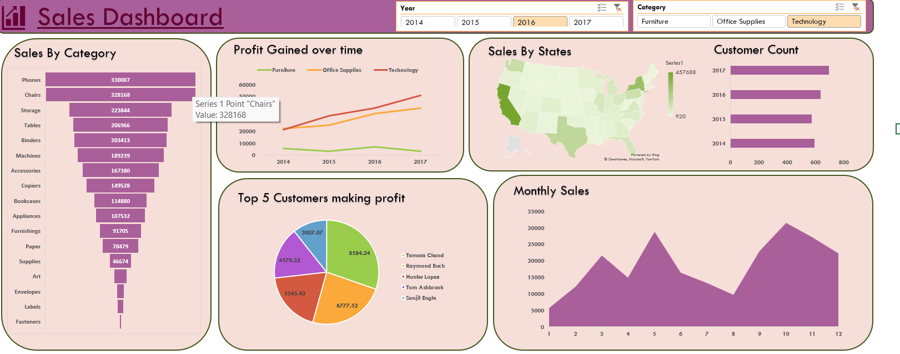

# Sales Performance Analysis Dashboard

An interactive Excel dashboard that tracks sales, profit, and customer purchasing behavior for a US retail business from 2014 to 2017. Sales data was cleaned and aggregated with Pivot Tables, then visualized in linked charts with Year and Category slicers, so the business can see which products, regions, and customers drive results.

> Add a screenshot of the dashboard (taken from Excel, with no slicer filters selected) to this repo as `dashboard.png`.

## Business Problem

A retail business wants to understand what is selling, what is profitable, and who is buying. This dashboard answers:

- Which sub-categories generate the most sales?
- How has profit changed over time in each category?
- Which states contribute the most sales?
- How is the customer base growing year over year?
- Which customers contribute the most profit?
- How do sales vary across months?

## Dashboard Features

- **Sales by Category:** funnel chart ranking sub-categories by total sales, from Phones and Chairs down to Fasteners.
- **Profit Gained Over Time:** line chart comparing Furniture, Office Supplies, and Technology from 2014 to 2017.
- **Sales by States:** map showing sales intensity across US states.
- **Customer Count:** bar chart of customers per year.
- **Top 5 Customers Making Profit:** pie chart of the most profitable customers.
- **Monthly Sales:** area chart showing the sales pattern across the 12 months.
- **Slicers:** filter the dashboard by **Year** (2014 to 2017) and **Category** (Furniture, Office Supplies, Technology).

## Key Insights

- **Phones and Chairs** are the top sub-categories by sales, at about 330K each.
- **Technology** is the highest-profit category by 2017, and its profit grows steadily across the four years.
- **Furniture** is consistently the lowest-profit category despite strong sales from Chairs, which points to a margin problem rather than a demand problem.
- Sales vary noticeably by month, with clear peaks and dips that can guide inventory and promotion timing.

## Recommendations

- Prioritize inventory and marketing for Technology products, the strongest and fastest-growing profit source.
- Review pricing, discounts, and costs in Furniture to improve margins.
- Plan stock and campaigns around the monthly sales peaks.
- Build retention efforts around the most profitable customers.

## Tools and Skills

- **Microsoft Excel:** Pivot Tables, Pivot Charts, Slicers, map and funnel charts
- **Data analysis:** data cleaning and aggregation, trend analysis, segmentation by category, region, customer, and time
- **Data storytelling:** turning charts into insights and recommendations

## Files

| File | Description |
|---|---|
| `Sales_Performance_Analysis.xlsx` | The workbook: cleaned data, pivot table sheets, and the dashboard sheet |
| `dashboard.png` | Screenshot of the finished dashboard |

> Replace `Sales_Performance_Analysis.xlsx` with the actual name of your file.

## How to Use

1. Download the workbook and open it in Microsoft Excel (2010 or later; the map chart needs a recent Excel version with internet access).
2. Go to the dashboard sheet.
3. Click the **Year** or **Category** slicers to filter the charts.
4. Click the clear-filter icon at the top right of a slicer to reset it.

## Author

**Amisha Verma**, Data Analyst
[LinkedIn](https://linkedin.com/in/amisha-verma543) | [GitHub](https://github.com/Amisha-verma2907)

